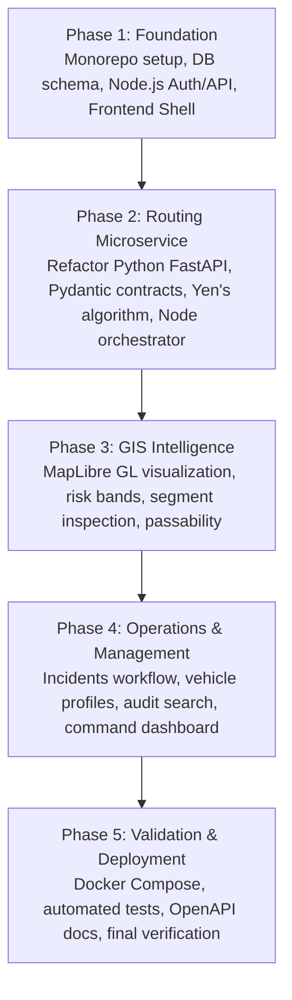

# RoadSafe AI — Repository Assessment & Migration Strategy

**Date:** 16 November 2026  
**Document Version:** 1.0  
**Status:** Baseline Audited & Architecture Finalized

---

## 1. Executive Summary

As mandated by Section 1 and Section 14 of the *RoadSafe AI Product & Engineering Specification*, an exhaustive inspection of the existing codebase (`SIH-2026-gis-router`), its algorithms, data models, APIs, and operational test suites was performed before making architectural changes.

The baseline prototype contained a monolithic Python/FastAPI service with NetworkX graph algorithms, SQLite/PostgreSQL models, and an early React/Leaflet dashboard. The target architecture separates public API concerns into a robust **Node.js (Express + TypeScript + Prisma)** application server, retains the scientific graph mathematics in a dedicated **Python (FastAPI + NetworkX + Shapely)** microservice isolated on an internal network, uses **PostgreSQL + PostGIS** as the single source of truth for spatial/relational data, and delivers a mission-critical **React + TypeScript + Vite + MapLibre GL** command center.

---

## 2. Baseline Inventory & Capability Matrix

| Component / Capability | Original Repository Status | Migration Action for RoadSafe AI | Target Architecture Owner |
|---|---|---|---|
| **Graph Construction & Yen's Algorithm** | Working in `graph_engine.py` (NetworkX `shortest_simple_paths`) | **Preserve & adapt** into `backend/routing-engine` | Python + FastAPI |
| **Constraint Pruning** | Prunes on `closed`, `blocked`, `max_vehicle_weight_kg`, and `allows_hazmat` | **Preserve & expand** to include vehicle width, clearance, and minimum safety threshold | Python (`prune_graph`) |
| **Passability & Risk Model** | Partial sigmoid implementation in `prediction_service.py` | **Formalize formula**: $z(e,v,t) = b_v - \sum w \cdot f$, $S = \text{sigmoid}(z)$, cost calculation with $\alpha, \beta, \gamma$ | Python (`passability/model.py`) |
| **Explainability & Rationale** | Working template generator in `graph_engine.build_rationale` | **Preserve deterministic rationale**; add bottleneck identification & confidence scoring | Python (`explainability/`) |
| **Public REST API & Auth** | FastAPI OAuth2 endpoint (`/api/v1/auth/login`) | **Migrate to Node.js**: JWT/session auth, bcrypt, RBAC (Admin, Dispatcher, Field Officer) | Node.js + Express + TS |
| **Database & ORM** | Mixed SQLAlchemy / SQLite / PostGIS | **Migrate to PostgreSQL + PostGIS** with Prisma + parameterized spatial queries | Node.js + Prisma / PostGIS |
| **Incident Lifecycle** | Multi-step reporting with conflict resolution in FastAPI | **Migrate workflow to Node.js**; persist in PostGIS; integrate with graph invalidation | Node.js + PostgreSQL |
| **Audit Logging** | Append-only `event_log` in SQLAlchemy | **Migrate to Node.js**: append-only audit trail with request IDs, hashes, and inputs | Node.js + PostgreSQL |
| **Frontend UI** | React 19 + Leaflet monolithic `App.jsx` | **Rebuild into modern React + TypeScript + Vite + MapLibre GL** with 9 dedicated screens | Frontend Client |
| **Containerization** | Simple `docker-compose.yml` for Postgres & API | **Create 4-service compose**: PostGIS, Node API, Python Routing Engine, Vite Frontend | Infrastructure |

---

## 3. Key Findings & Preserved Routing Assets

1. **Routing Logic Preservation**:
   - The NetworkX directed graph representation (`nx.DiGraph`) correctly models nodes as junctions/villages and edges as directed road segments.
   - The loopless K-shortest paths using `nx.shortest_simple_paths` is computationally sound and will be preserved directly.
   - The multi-objective cost function balancing travel time, risk penalty ($-\ln(S)$), and resource expenditure matches Section 4 of the new specification.
2. **Determinism & Explainability**:
   - The existing rationale engine generates clear explanations from numeric facts (e.g. edge weights, closure reasons, high-risk flags) rather than unconstrained LLM hallucinations. This deterministic pattern is strictly maintained.
3. **Data Quality & Demo Network**:
   - The seeded East Khasi Hills dataset provides 12 nodes, 16 edges, river bridge limits, and varying hazard profiles.
   - We maintain this validated network and provide clear demo/simulation labeling across all UI views and API payloads.

---

## 4. Phase-by-Phase Execution Roadmap

---

## 5. Architectural Invariants

- **Boundary Separation**: Node.js is the **only** public-facing API. Python is private/internal and accepts requests only over the Docker network or local internal port.
- **Contract Synchronization**: Pydantic models in Python and TypeScript interfaces in Node.js & React are 100% synchronized with comprehensive contract validation.
- **Explainability**: No routing recommendation is emitted without an explicit confidence score, bottleneck identification, and structured rationale.
- **Safety**: Hard constraints (closures, weight, width) are never traded off as soft cost penalties. Prohibited edges are pruned outright.

